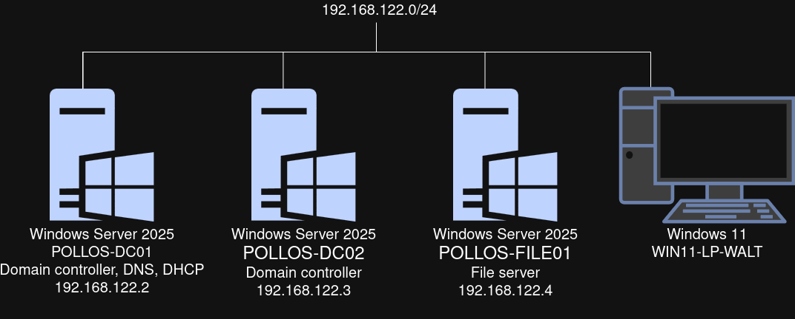
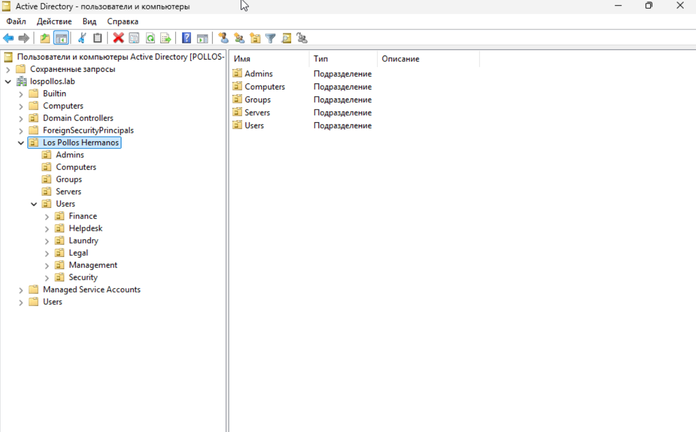
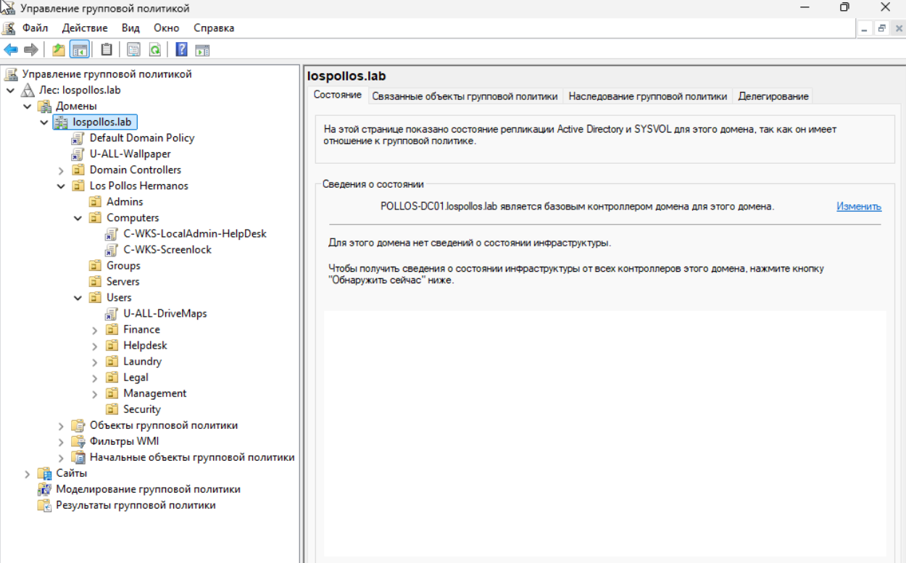

# Active Directory & GLPI virtual lab
This repository shows my hands-on experience with Active Directory and GLPI.

## Table of contents
- [Active Directory](#active-directory)
  - [Diagram](#diagram)
  - [Organizational structure](#organizational-structure)
  - [GPOs](#gpos)
- [Automation with Powershell](#automation-with-powershell)
- [Helpdesk](#helpdesk)
  - [Case #1: User forgot password and got account locked](#case-1-user-forgot-password-and-got-account-locked)
  - [Case #2: Onboarding](#case-2-onboarding)
  - [Case #3: User can't access shared folder](#case-3-user-cant-access-shared-folder)

## Active Directory
### Diagram


### Organizational structure
```
lospollos.lab
└── Los Pollos Hermanos
    ├── Admins        ← a-heisenberg, a-fring
    ├── Computers     ← WIN11-LP-WALT
    ├── Disabled
    ├── Groups
    │   ├── GG_Management
    │   ├── GG_Laundry
    │   ├── GG_Legal
    │   ├── GG_Security
    │   ├── GG_Finance
    │   ├── GG_Helpdesk
    │   └── GG_Admins
    ├── Servers       ← POLLOS-FILE01 (file server)
    └── Users
        ├── Finance      ← Skyler White
        ├── Helpdesk     ← Tuco Salamanca
        ├── Laundry      ← Walter White, Jesse Pinkman
        ├── Legal        ← Saul Goodman
        ├── Management   ← Gustavo Fring
        └── Security     ← Mike Ehrmantraut
```


*Active Directory Users and Computers: the Los Pollos Hermanos OU tree.*
### GPOs
| Policy                        | Link                  | Configuration                                                              |
| ----------------------------- | --------------------- | -------------------------------------------------------------------------- |
| **Password and lockout**      | Default domain policy | - Minimum password length  12<br>- Lockout after 5 attempts<br>- 15m lockout |
| **U-ALL-DriveMaps**           | Users                 | Automatically maps shared folder from FILE01                               |
| **C-WKS-LocalAdmin-Helpdesk** | Computers             | Adds GG_Helpdesk to the local Administrators group                         |
| **C-WKS-ScreenLock**          | Computers             | Locks screen after 600 seconds of inactivity                                |
| **U-ALL-Wallpaper**               | Root                  | Changes wallpaper                                                          |



## Automation with PowerShell

| Name | Description                                                                                                                                                                                                                                                                                                           |
| ---- | --------------------------------------------------------------------------------------------------------------------------------------------------------------------------------------------------------------------------------------------------------------------------------------------------------------------- |
| [**User creator**](automation/user-creator.ps1) | **Creates users from the csv file**<br>- Puts users in the OU corresponding to their department<br>- Adds users to the group corresponding to their department<br>- Generates SamAccountName with collision handling<br>- Generates temporary password<br>- Saves as csv their SamAccountNames and temporary password |
| [**Offboarding**](automation/offboarding.ps1)  | **Offboards users from the csv file**<br>- Disables account<br>- Generates new password<br>- Removes from any membership<br>- Moves users to the Disabled OU                                                                                                                                                           |


## Helpdesk 
In this section I'll cover some tickets from user on GLPI.

### Case #1: User forgot password and got account locked

- **Ticket:** Jesse forgot his password and got his account locked after 5 login atempts
- **Solution:** Go to "Users and computers", right-click the user, reset password and unlock the account

### Case #2: Onboarding
- **Ticket:** New employee Jimmie McGill
- **Solution:** Go to "Users and computers" and create new user with new password on next logon

### Case #3: User can't access shared folder
- **Ticket:** New employee Jimmie McGill can't access Legal shared folder
- **Solution:** Check user's groups with `Get-ADPrincipalGroupMembership jmcgill | Select-Object Name`. The onboarding step “add to department group” was missed. Fix is to add Jimmie to the GG_Legal