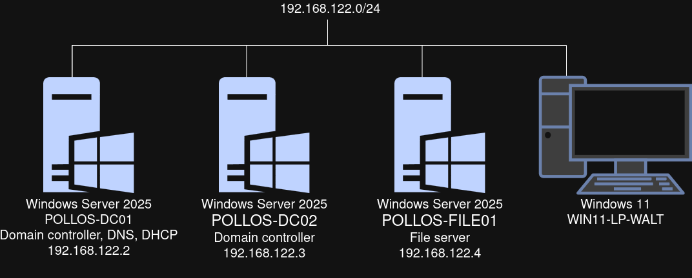
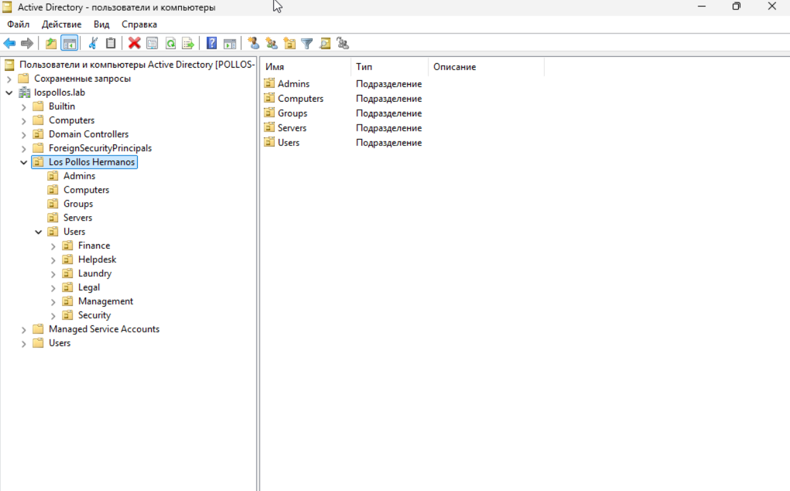
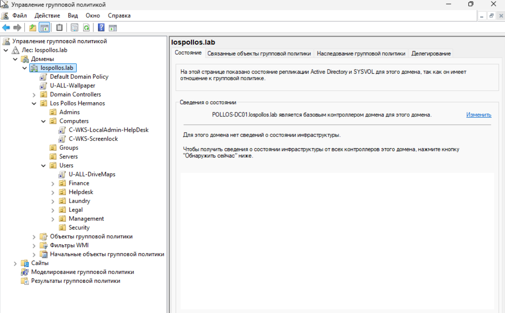

[English](README.md) | **Русский**

# Виртуальный стенд Active Directory & GLPI
В этом репозитории показан мой практический опыт работы с Active Directory и GLPI.

## Оглавление
- [Active Directory](#active-directory)
  - [Схема](#схема)
  - [Организационная структура](#организационная-структура)
  - [GPO](#gpo)
- [Автоматизация с помощью PowerShell](#автоматизация-с-помощью-powershell)
- [Служба поддержки](#служба-поддержки)
  - [Кейс #1: Пользователь забыл пароль и получил блокировку учётной записи](#кейс-1-пользователь-забыл-пароль-и-получил-блокировку-учётной-записи)
  - [Кейс #2: Онбординг](#кейс-2-онбординг)
  - [Кейс #3: Пользователь не может получить доступ к общей папке](#кейс-3-пользователь-не-может-получить-доступ-к-общей-папке)

## Active Directory
### Схема


### Организационная структура
```
lospollos.lab
└── Los Pollos Hermanos
    ├── Admins        ← a-heisenberg, a-fring
    ├── Computers     ← WIN11-LP-WALT
    ├── Disabled
    ├── Groups
    │   ├── GG_Management
    │   ├── GG_Laundry
    │   ├── GG_Legal
    │   ├── GG_Security
    │   ├── GG_Finance
    │   ├── GG_Helpdesk
    │   └── GG_Admins
    ├── Servers       ← POLLOS-FILE01 (файловый сервер)
    └── Users
        ├── Finance      ← Skyler White
        ├── Helpdesk     ← Tuco Salamanca
        ├── Laundry      ← Walter White, Jesse Pinkman
        ├── Legal        ← Saul Goodman
        ├── Management   ← Gustavo Fring
        └── Security     ← Mike Ehrmantraut
```


*Active Directory Users and Computers: дерево OU Los Pollos Hermanos.*
### GPO
| Политика                      | Объект применения     | Конфигурация                                                               |
| ----------------------------- | --------------------- | -------------------------------------------------------------------------- |
| **Password and lockout**      | Default domain policy | - Минимальная длина пароля 12<br>- Блокировка после 5 попыток<br>- Блокировка на 15 минут |
| **U-ALL-DriveMaps**           | Users                 | Автоматически подключает общую папку с FILE01                              |
| **C-WKS-LocalAdmin-Helpdesk** | Computers             | Добавляет GG_Helpdesk в локальную группу Administrators                    |
| **C-WKS-ScreenLock**          | Computers             | Блокирует экран после 600 секунд бездействия                               |
| **U-ALL-Wallpaper**               | Root                  | Меняет обои                                                                |



## Автоматизация с помощью PowerShell

| Название | Описание                                                                                                                                                                                                                                                                                          |
| ---- | --------------------------------------------------------------------------------------------------------------------------------------------------------------------------------------------------------------------------------------------------------------------------------------------------------------------- |
| [**User creator**](automation/user-creator.ps1) | **Создаёт пользователей из csv-файла**<br>- Помещает пользователей в OU, соответствующий их отделу<br>- Добавляет пользователей в группу, соответствующую их отделу<br>- Генерирует SamAccountName с обработкой коллизий<br>- Генерирует временный пароль<br>- Сохраняет в csv их SamAccountName и временный пароль |
| [**Offboarding**](automation/offboarding.ps1)  | **Увольняет пользователей из csv-файла**<br>- Отключает учётную запись<br>- Генерирует новый пароль<br>- Удаляет все членства<br>- Перемещает пользователей в OU Disabled                                                                                                                                                           |


## Служба поддержки 
В этом разделе я разберу несколько обращений от пользователей в GLPI.

### Кейс #1: Пользователь забыл пароль и получил блокировку учётной записи

- **Обращение:** Jesse забыл пароль и получил блокировку учётной записи после 5 неудачных попыток входа
- **Решение:** Перейти в "Users and computers", кликнуть правой кнопкой мыши по пользователю, сбросить пароль и разблокировать учётную запись

### Кейс #2: Онбординг
- **Обращение:** Новый сотрудник Jimmie McGill
- **Решение:** Перейти в "Users and computers" и создать нового пользователя с новым паролем и сменой пароля при следующем входе

### Кейс #3: Пользователь не может получить доступ к общей папке
- **Обращение:** Новый сотрудник Jimmie McGill не может получить доступ к общей папке Legal
- **Решение:** Проверить группы пользователя с помощью `Get-ADPrincipalGroupMembership jmcgill | Select-Object Name`. На этапе онбординга был пропущен шаг «добавление в группу отдела». Исправление - добавить Jimmie в GG_Legal
